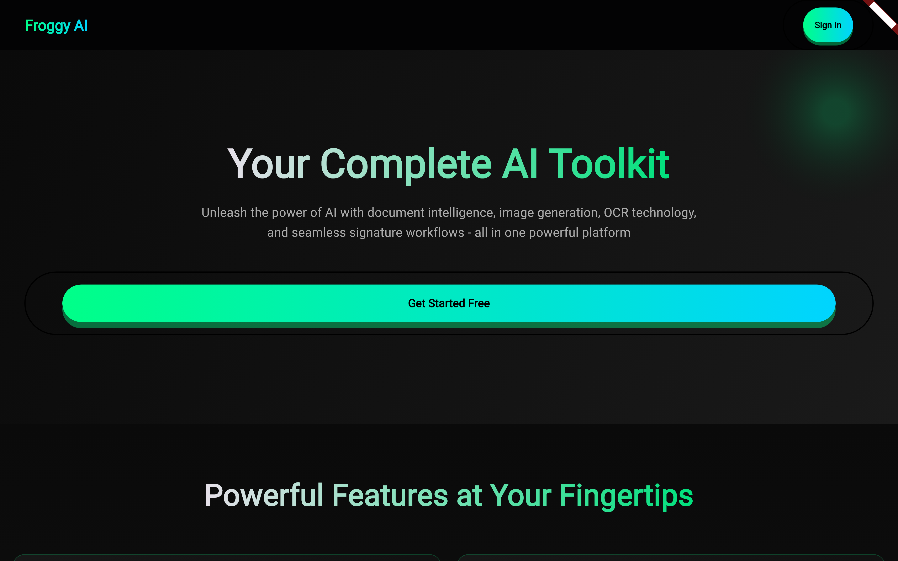
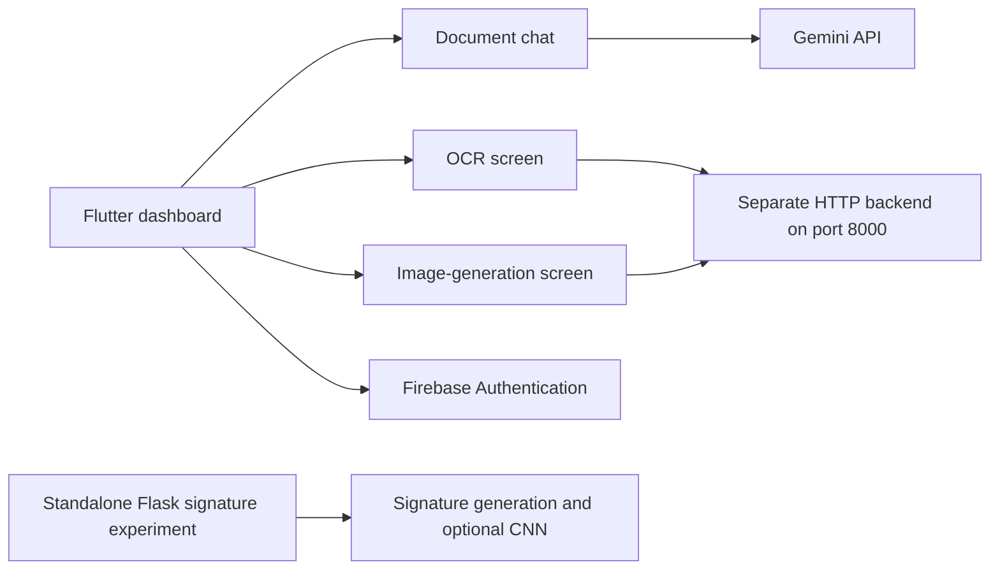

# DocuMind

A Flutter AI workspace prototype with document chat, OCR, image-generation screens, Firebase accounts, and a separate Python signature-generation experiment.

The repository demonstrates a modular client integrating document selection, a Gemini chat flow, and HTTP-based AI tools. Some required backend services live outside this checkout.

## Interface preview

The responsive landing experience introduces the platform's document intelligence, image generation, OCR, and signature workflows in a unified AI workspace.



## Stack and architecture

Flutter / Dart `^3.9.2`, Firebase Authentication and related Firebase SDKs, `google_generative_ai`, `file_picker`, `http`, and `flutter_dotenv` form the app. The bundled signature experiment uses Flask, Pillow/OpenCV, TensorFlow/Keras, NumPy, and pandas.



The `Signature Flow/` Flask application is a separate experiment. It does not implement the OCR/image-generation endpoints used by the Flutter client.

## Flutter setup

```sh
git clone https://github.com/Abdul-Hadi-Jalil/DocuMind.git
cd DocuMind
flutter pub get
flutter devices
```

Configure Firebase for your project and enabled authentication. Review both `lib/firebase_options.dart` and `lib/main.dart`: the web bootstrap currently contains an additional inline Firebase initialization, so web startup needs validation.

Create an ignored root `.env` with your own Gemini key:

```dotenv
API_KEY=YOUR_GEMINI_API_KEY
```

The Flutter manifest declares `.env` as an asset and startup loads it. This makes the file necessary for the existing boot path, but does not protect secrets in distributed builds.

```sh
flutter run -d <device-id>
```

## External service requirements

| Feature | Current integration |
| --- | --- |
| Document chat | Direct Gemini call; model ID is configured in the screen |
| OCR | `POST http://127.0.0.1:8000/upload-image/` |
| Image generation | `POST http://127.0.0.1:8000/generate-image/` |
| Signature experiment | Separate Flask app in `Signature Flow/` |

The FastAPI implementation for the OCR and image-generation routes is not included here. Obtain/configure that service separately and match its payloads to the screen code before demonstrating those modules. On an Android emulator, the host machine is `10.0.2.2`; the current URLs are hardcoded in their screen files.

Older run guides refer to another backend directory, port 8001, and files/modules absent from this checkout. They are historical notes and do not provide a complete setup for the present tree.

## Standalone signature experiment

```sh
cd "Signature Flow"
python -m venv .venv
```

Activate the environment, then:

```sh
python -m pip install -r requirements.txt
python app.py
```

This starts the Flask development app, normally on port 5000. It renders `templates/index.html`, writes generated output under `static/output/`, and can evaluate signatures if the model and class metadata are available. `cnn_predict.py` expects `cnn_signature_model.h5` and `label_classes.npy`; the model is present, but verify metadata and datasets before assuming CNN inference is ready. Use only trusted artifacts.

## Code map

- `lib/features/auth/`: account and landing screens.
- `lib/features/dashboard/`: module navigation.
- `lib/features/pdf_chat/`: document selection and Gemini conversation.
- `lib/features/ocr/`: image upload and extracted-text interface.
- `lib/features/image_generation/`: prompt and generated-image interface.
- `Signature Flow/`: Python prototype, model, template, and output assets.

## Verification and scope

Run `flutter analyze` and `flutter test` from the root; if a test directory is absent, record that rather than treating the project as covered. Validate each module with its actual service and test platform startup separately. No end-to-end success is implied by the setup commands.

This is an integration prototype. Reproducible external backend setup, centralized service configuration, protected provider credentials, and module-level tests are important next steps.
